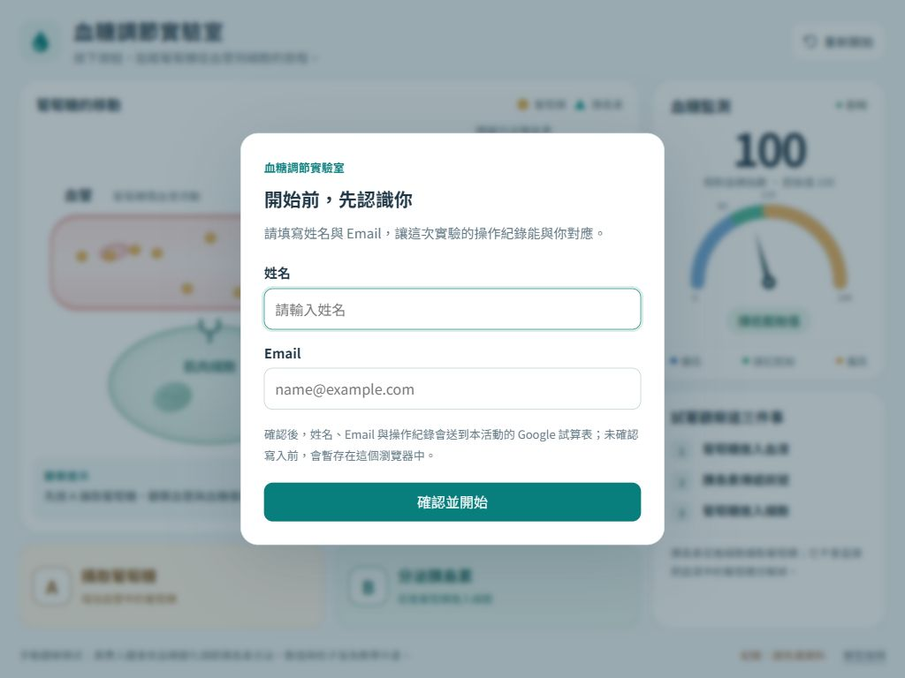

# 血糖調節實驗室

一個給高中生使用的「胰島素與葡萄糖調節」互動模擬器。學生可以按 A 增加血管中的葡萄糖，再按 B 觀察胰島素訊號、葡萄糖進入肌肉細胞，以及血糖儀表下降的關係。

程式以**單一 HTML** 製作，內含 CSS、JavaScript 與 SVG 圖像，採繁體中文介面。以 iPad 橫式的一頁操作為主要設計目標，也提供手機與電腦版面。

文件整理日期：2026-11-24。

## 1. 快速開始

### 在電腦使用

1. 找到 `胰島素與葡萄糖調節模擬器.html`。
2. 使用網頁瀏覽器開啟，例如對檔案按右鍵，選擇以瀏覽器開啟。
3. 畫面出現血管、細胞、兩個操作按鈕與血糖儀表後，即可使用。

不需要安裝套件，也不需要先啟動伺服器。進入時會先要求填寫姓名與 Email；確認後便可操作。HTML 本身包含模擬需要的程式與圖像，模擬可離線執行；把資料送到 Google 試算表則需要網路，以及已設定好的 GAS 部署網址。

### 在手機、平板使用

本頁會依瀏覽器可用寬度調整版面；iPad 建議以橫式操作。

請使用能執行網頁 JavaScript 的瀏覽器開啟。部分檔案管理或通訊軟體只提供附件預覽，可能不執行互動程式；附件可以預覽，並不代表已經在完整的瀏覽器中執行。需要讓多位學生直接點網址使用時，可將這一個 HTML 放到支援靜態網頁的網站空間。本次交付的是本機檔案，未提供已發布的對外網址。

## 2. 檔案內容

```text
成果/
├── 胰島素與葡萄糖調節模擬器.html       ← 可執行的模擬器，也是原始碼
├── 胰島素與葡萄糖調節模擬器_預覽.jpg  ← 靜態預覽圖片
├── README.md                         ← 本說明書
├── LOG.md                            ← 初學者開發紀錄與程式解說
├── api/
│   ├── save.js                       ← Vercel 中間代理 POST /api/save
│   └── README.md                     ← GAS_URL 設定與代理呼叫方式
└── _gs/
    ├── Code.gs                       ← Google Apps Script 接收與寫入程式
    └── README.md                     ← 部署、設定與資料紀錄說明
```

要執行前端模擬，只需要 HTML。要啟用 Google 試算表紀錄，另需部署 `_gs/Code.gs`。預覽圖片不是按鈕可操作的網頁；README 與 LOG 則是文字文件。



## 3. 如何操作

| 操作 | 畫面變化 | 可觀察的重點 |
| --- | --- | --- |
| 按 A「攝取葡萄糖」 | 血管內新增橘色六角形粒子，儀表數值上升 | 攝取葡萄糖後，血液中的葡萄糖增加 |
| 按 B「分泌胰島素」 | 出現綠色三角形訊號，接著葡萄糖移入細胞 | 胰島素促進肌肉細胞攝取葡萄糖，血管內的葡萄糖減少 |
| 按「重新開始」 | 清除目前狀態，恢復起始粒子與數值 | 重新比較不同操作順序 |
| 按「模型說明」 | 開啟模型規則、限制與概念資料連結 | 確認這個簡化模型呈現的範圍 |
| 按頁面下方「紀錄」 | 查看待送出數量、立即同步或下載暫存備份 | 尚未確認寫入的紀錄不會被當作已儲存 |

電腦也可以按鍵盤 **A**、**B** 操作。開啟模型說明時，這兩個快捷鍵暫停作用，避免閱讀時誤觸。

### 第一次操作可以照這個順序

1. 在進入視窗填寫姓名與 Email，按「確認並開始」。Email 會檢查格式，但不會寄送驗證信。
2. 按「重新開始」：血管 20 顆、細胞 0 顆，指數為 100。
3. 按一次 A：血管變成 26 顆，指數升到 130。
4. 按一次 B，等待這次轉移動畫完成：血管回到 20 顆、細胞增加到 6 顆，指數回到 100。
5. 比較前後位置：這 6 顆葡萄糖進入了細胞，並不是直接消失。

## 4. 儀表與模型規則

### 相對血糖指數

```text
相對血糖指數 = 仍計入血管的葡萄糖粒子數 × 5
```

這個指數沒有 mg/dL 等生理單位。每顆粒子代表 5 點，是為了方便觀察而設定的教學比例，並非人體的實際換算。

| 項目 | 目前設定 |
| --- | --- |
| 起始狀態 | 血管 20 顆、細胞 0 顆、指數 100 |
| A 每次攝取 | 最多新增 6 顆，指數最多增加 30 |
| B 每次作用 | 最多轉移 6 顆到細胞，完成後指數最多減少 30 |
| 血管顯示上限 | 48 顆，對應指數 240 |
| 下限 | 血管 0 顆，指數 0 |
| 低於 80 | 顯示「低於起始範圍」，搭配藍色狀態 |
| 80–120，包含端點 | 顯示「接近起始值」，搭配綠色狀態 |
| 高於 120 | 顯示「高於起始範圍」，搭配橘色狀態 |

上述區間是本模型自訂的顯示規則，不能用來判讀真實血糖。

### 操作邊界

- 接近上限時，A 只補到上限。例如血管有 44 顆時，下一次只加 4 顆。
- 到達上限時，A 暫時不能按；轉移出部分葡萄糖後，A 會恢復可用。
- 血管不足 6 顆時，B 只轉移剩餘粒子。例如剩 2 顆，就只轉移 2 顆。
- 血管沒有葡萄糖時，B 暫時不能按。
- B 動畫執行期間，B 會顯示「胰島素作用中…」並暫停接受新的操作；A 在未達上限時仍可使用。
- 動畫途中可以按「重新開始」，立即還原。
- 葡萄糖正在移動時，仍暫時計入血管；抵達細胞時，才同步更新兩邊計數與儀表。因此動畫途中可能短暫看見粒子已離開血管圖形，但計數還沒減少。

## 5. 教學範圍

本模擬讓學生觀察：葡萄糖進入血液後，血糖指數上升；胰島素傳遞訊號後，促進肌肉細胞攝取葡萄糖，血糖指數下降。

使用時請一併說明以下簡化：

- 胰島素由使用者按 B 手動觸發，沒有自動分泌的回饋控制。
- 圖中的粒子大小、數量、移動速度與反應時間都是示意。
- 胰島素的作用位置與葡萄糖移入細胞的路徑在圖中分開呈現；不代表胰島素本身就是葡萄糖通道。
- 進入細胞的粒子會留在畫面中，尚未模擬後續利用或儲存。
- 沒有呈現肝臟、升糖素、糖原代謝、不同組織差異等完整調節機制。
- 指數可以降到 0，是程式的教學邊界，不是對人體正常情況的描述。

程式內「模型說明」提供的概念資料為 [美國 NIDDK：What Is Diabetes?](https://www.niddk.nih.gov/health-information/diabetes/overview/what-is-diabetes)。只有開啟外部資料連結時需要網路。

## 6. 技術構成

| 技術 | 在本專案的工作 |
| --- | --- |
| HTML | 定義標題、按鈕、文字、儀表與說明視窗 |
| CSS | 設定顏色、排版、尺寸及不同螢幕寬度的樣式 |
| JavaScript | 處理操作、粒子數量、動畫、儀表更新與重設 |
| SVG | 繪製血管、細胞、胰臟、粒子與儀表指針 |

目前沒有使用外部 JavaScript 套件、前端框架、生成式 AI API 或 Google 帳號登入驗證。新增的 GAS 後端會把姓名、Email 與事件寫入指定 Google 試算表；前端使用 localStorage 暫存待送資料。

重新整理會讓模擬回到起始狀態，並再次顯示資料輸入視窗；尚未送出的紀錄仍保留在原瀏覽器中。模擬狀態與操作紀錄是兩件不同的事：保存待送紀錄，不代表會還原上次的血糖數值。待送的舊紀錄會保留原姓名與 Email，不會改掛到下一位使用者名下。

## 7. 想修改程式，從哪裡開始？

使用純文字或程式碼編輯器開啟 HTML，搜尋下列位置：

| 想修改的內容 | 搜尋關鍵字 | 注意事項 |
| --- | --- | --- |
| 頁面標題 | `<h1>`、`<title>` | 頁面大標題與瀏覽器分頁名稱分開設定 |
| 主要顏色 | `:root` | 部分 SVG 圖形另有自己的 `fill`、`stroke` 顏色 |
| 起始血管粒子數 | `const INITIAL` | 要同步檢查起始值文字、說明及預期測試結果 |
| 每次操作的粒子數 | `const PER_ACTION` | A 與 B 共用這個設定，修改後兩者都會改變 |
| 血管粒子上限 | `const MAX_BLOOD` | 上限與儀表最大值、刻度及指針公式需要一致 |
| 每顆粒子對應幾點 | `const POINTS_PER_PARTICLE` | 會影響起始值、操作增減量與儀表範圍 |
| 小螢幕排版 | `@media` | 修改後要重新檢查不同尺寸 |

目前部分儀表刻度、區間與說明文字直接寫在 HTML 中，並沒有全部由設定值自動產生。改數字時，不能只改一個常數就假定所有畫面已同步。

更詳細的程式導讀、修改範例及問題排查，請閱讀 [LOG.md](LOG.md)。

## 8. 驗證範圍與目前限制

先前開發階段已透過瀏覽器檢查 A/B 操作、粒子總數、上限、下限、動畫中重設、鍵盤操作及模型說明視窗。

也曾以 10 組瀏覽器視窗尺寸檢查排版，包含 1024 × 768、1180 × 820、1194 × 834 等 iPad 橫式代表尺寸，以及手機直式、電腦與窄高版面；當時主要控制項沒有被裁切，也沒有頁面水平或垂直捲動。完整尺寸與觀察結果列於 LOG。

這些是**瀏覽器視窗尺寸檢查**，不等同於已在每一款實體 iPad、手機或各家瀏覽器上驗證。手機樣式有 620px 的最低頁面高度；更矮的視窗、放大字體或瀏覽器縮放仍可能需要捲動。窄版會隱藏側欄的三步驟說明，保留主要操作、動畫、數值及粒子計數。

新增紀錄功能後，另做登入視窗、Email 格式、成批暫存與重新整理的瀏覽器檢查，並重新確認 1024 × 768、1180 × 820、390 × 844、375 × 667、360 × 640、844 × 390 六組版面。GAS 與前端紀錄的本機替身測試另驗證每批 5 事件、失敗保留、去重與錯誤回傳。接入實際部署後，也已另外用測試資料驗證登入紀錄與 5 個操作事件寫入 Google 試算表。

## 9. 常見問題

**打開後只看到程式文字？**

請確認是用瀏覽器開啟 `.html`，而不是用文字編輯器檢視原始碼。也請確認檔名沒有變成 `.html.txt`。

**按 B 沒有反應？**

先看是否顯示「胰島素作用中…」，或血管內是否已經是 0 顆。前者需要等待動畫完成；後者可以先按 A，或重新開始。

**手機看得到圖片，按鈕卻不能操作？**

請確認開啟的是 HTML，而不是 JPG 預覽圖片，也不是只顯示靜態內容的附件預覽。

**改完檔案，畫面還是舊的？**

先儲存，再重新整理瀏覽器。確認修改與開啟的是同一份 HTML。使用網頁網址預覽時，也要確認已更新該網址對應的檔案。

**想了解從需求到程式的完整過程？**

閱讀 [LOG.md：開發紀錄與初學者程式解說](LOG.md)，可依章節逐步理解，不需要先讀完整份原始碼。

## 10. 姓名、Email 與 Google 試算表紀錄

- 確認身分後，先立即送出一筆 `identify` 紀錄。
- 一般操作事件每 5 個包成一批，每批在 `logSheet` 新增一列。
- 欄位為 `timeStamp`、`userName`、`userEmail`、`log`。`log` 以 JSON 保存批號、工作階段及事件。
- 點擊按鈕、連結，以及一般輸入欄位的變更都可記錄。鍵盤 A/B 也走相同的按鈕紀錄流程；動畫影格不會各算成一個事件。
- 文字輸入停止約 600 毫秒，或欄位確認變更時才記錄；不逐字上傳。單次欄位值最多保留 1000 字元。
- 身分表單只在確認時建立身分紀錄，不保存每次輸入姓名或 Email 的中間字串；密碼、隱藏、檔案欄位與同步管理控制項不記錄。
- 未滿 5 個的剩餘事件在立即同步、切換到背景或離開時會封成一批並嘗試送出。
- 只有收到 `OK`，或透過只讀查詢確認同一批已存在，才刪除該批暫存。失敗會保留並重試。
- 「重新開始」只重設生物模擬，不刪除操作紀錄。

部署與設定方式請看 [_gs/README.md](./_gs/README.md)。目前已將提供的 `/exec` 網址填入前端，並將部署的存取對象設為「所有人」，可供學生免登入提交；已確認測試資料寫入成功。編輯器網址不能代替接收網址。

localStorage 與來源網址、瀏覽器及裝置相關。清除網站資料、改用另一個來源或瀏覽器，不能保證讀到原暫存。這版共用同來源的暫存區，請同一個瀏覽器來源一次使用一個模擬器分頁，避免同時改寫；若暫存失敗，介面會提示並提供下載備份。

## 11. Vercel 中間代理

新增的 `api/save.js` 可接收前端 POST，從伺服器環境變數 `GAS_URL` 取得接收網址，再轉送至 GAS，原樣回傳結果。此檔案已完成本機測試，尚未部署至 Vercel；目前 HTML 的資料傳送仍是前節已驗證的直接 GAS 方式。

使用代理時，請將本資料夾設為 Vercel 專案根目錄，設定 `GAS_URL`，部署後再讓前端呼叫同網站的 `/api/save`。完整設定與範例見 [api/README.md](./api/README.md)。
